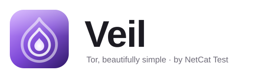
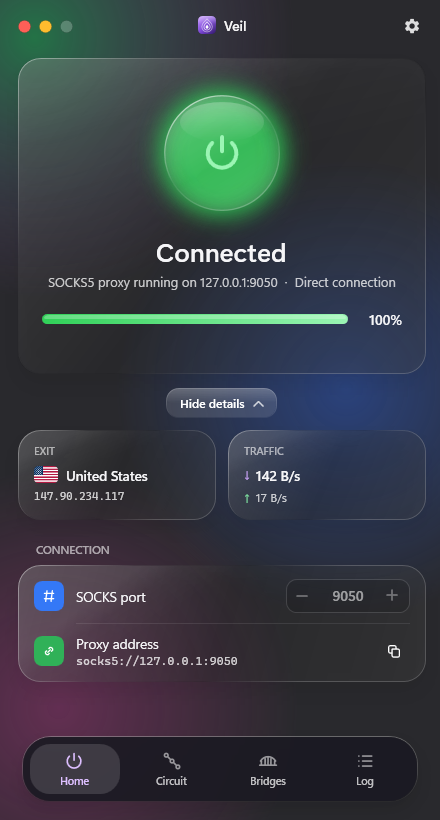
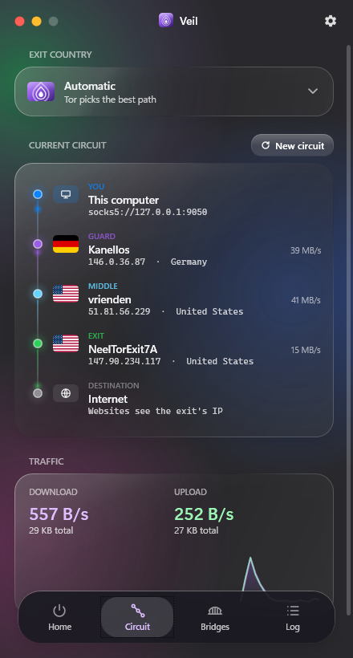
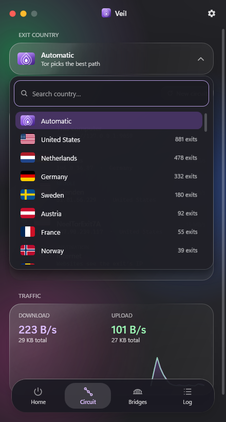
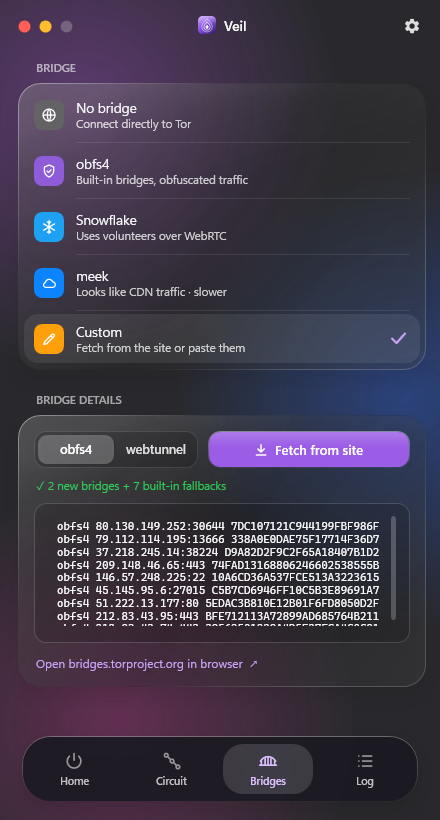
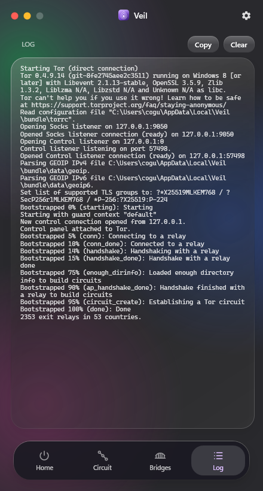
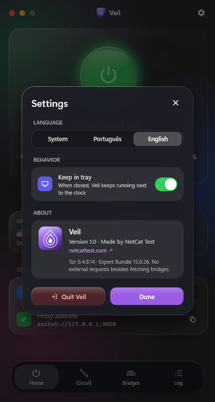

<div align="center">

<picture>
  <source media="(prefers-color-scheme: dark)" srcset="docs/wordmark-dark-en.svg">
  
</picture>

**The Tor network on Windows, beautifully simple. One executable, everything local.**

[](#requirements)
[](#stack)
[](https://www.torproject.org)
[](#)
[](LICENSE)
[](https://github.com/netcattest/veil/actions/workflows/build.yml)

**[⬇️ Download Veil](https://github.com/netcattest/veil/releases/latest)**

[🇧🇷 Português](README.md) · 🇺🇸 English

<br>

&nbsp;&nbsp;
&nbsp;&nbsp;


</div>

---

## ✨ What it is

**Veil** is a Tor control panel built for Windows. It ships the **official Tor Expert Bundle inside a single `Veil.exe`**. Turn the network on and off with one tap, pick the port, use bridges to get around censorship, choose your exit country and watch **your circuit live**: every relay with its flag, IP, country and bandwidth.

No installer, no dependencies, no telemetry. The only connection Veil makes on its own is fetching fresh bridges, and only when you click **Fetch from site**.

## 🧭 Features

| | |
|---|---|
| ⏻ **On / off** | Glowing glass power button and a progress bar with the real bootstrap stage (including MB of relay descriptors downloaded) |
| 🔌 **SOCKS5 port** | Choose the port (default `9050`) and copy the proxy address in one click |
| 🧅 **Live circuit** | You → Guard/Bridge → Middle → Exit → Internet, with flag, IP, country and bandwidth for every relay and animated dots showing the flow |
| 🌍 **Exit country** | Custom searchable dropdown with 252 flags, sorted by the real number of exit relays per country (computed from the local consensus) |
| 🔄 **New circuit** | Requests a new identity (`NEWNYM`) and shows the new circuit |
| 🌉 **Bridges** | Built-in obfs4, Snowflake and meek, or **Custom**: fetch obfs4/webtunnel from the official site or paste bridge lines |
| 📈 **Traffic** | Download/upload per second, totals and a lightweight 60-second chart |
| 🗂️ **Tray** | Closing keeps Veil running; right-click opens a glass menu with status, country, exit IP and traffic |
| 🌐 **Languages** | Portuguese and English, automatic from the system language |
| 🫧 **Look & feel** | Real Windows 11 acrylic, "liquid glass" cards, a splash where the logo draws itself, open/close animations and a jelly effect when dragging |

## 📸 Screens

<div align="center">

| Home | Circuit | Exit country |
|:---:|:---:|:---:|
|  |  |  |
| **Bridges** | **Log** | **Settings** |
|  |  |  |

</div>

## 🛠️ How it works

<div align="center">

</div>

1. **First run**: `Veil.exe` extracts the embedded Tor Expert Bundle to `%LOCALAPPDATA%\Veil\bundle` (once per version).
2. **On connect**: Veil writes a `torrc` with your SOCKS port, bridges and exit country, then starts `tor.exe` inside a Windows *Job Object*. If Veil closes or crashes, Tor and its transports go with it.
3. **Progress**: Veil reads Tor's log (stdout) and polls `status/bootstrap-phase` every 0.5 s to show the exact percentage.
4. **Live data**: through the local **ControlPort** (random port, cookie authentication), Veil asks for:

| Command | Why |
|---|---|
| `GETINFO circuit-status` · `stream-status` | which circuit is in use right now |
| `GETINFO ns/id/<fingerprint>` | each relay's nickname, IP and bandwidth |
| `GETINFO ip-to-country/<ip>` | the relay's country, from Tor's **local GeoIP** |
| `GETINFO traffic/read` · `traffic/written` | traffic per second |
| `GETINFO ns/all` | counts exit relays per country to sort the list |
| `SETCONF ExitNodes={cc} StrictNodes=1` | switches exit country without restarting |
| `SIGNAL NEWNYM` | new circuit |

5. **Your apps** use the `socks5://127.0.0.1:9050` proxy (or whichever port you chose).

### 🔒 Privacy

- **No external requests** from Veil itself, with one exception: fetching bridges, which happens **only when you click "Fetch from site"**. It uses the official **Moat** API at `bridges.torproject.org` (the same one Tor Browser uses, no CAPTCHA).
- Flags, country names and GeoIP are **embedded**.
- Settings and Tor's cache live in `%LOCALAPPDATA%\Veil`. Delete that folder to remove everything.

> [!IMPORTANT]
> Veil provides a **Tor proxy** for your apps. It is **not** a replacement for [Tor Browser](https://www.torproject.org/download/). A regular browser routed through Tor is still exposed to fingerprinting, cookies and logins. For anonymous browsing, use Tor Browser.

## 🌉 Bridges

| Mode | When to use it |
|---|---|
| **No bridge** | Open networks: direct and fastest |
| **obfs4** | Built-in bridges that disguise Tor traffic |
| **Snowflake** | Uses volunteers over WebRTC; good when obfs4 is blocked |
| **meek** | Looks like CDN traffic; slower but hard to block |
| **Custom** | Fetches fresh **obfs4** or **webtunnel** bridges from the official site (obfs4 comes with the built-in ones as fallback) or takes pasted lines such as `obfs4 1.2.3.4:443 FINGERPRINT cert=… iat-mode=0` |

## 🚀 Usage

1. Download from **[Releases](https://github.com/netcattest/veil/releases/latest)**:
   - **`Veil-Setup.exe`** (recommended): installs for your user, no admin, with Start menu and desktop shortcuts. Uninstall from *Settings → Installed apps*.
   - **`Veil.exe`**: portable version, just run it.
2. Tap the center button. Once it says **Connected**, point your app to the **SOCKS5** proxy `127.0.0.1:9050`.
3. In Firefox: *Settings → Network → Manual proxy → SOCKS v5*, and tick **"Proxy DNS when using SOCKS v5"**.
4. Test it:

```bash
curl --socks5-hostname 127.0.0.1:9050 https://check.torproject.org/api/ip
```

> SmartScreen may warn on first run because the executable isn't signed yet: click **More info → Run anyway**. Each release ships SHA-256 hashes in `SHA256SUMS.txt`.

### Requirements

Windows 10 or 11 (64-bit) with .NET Framework 4.8, which ships with Windows. Real acrylic glass needs Windows 11 22H2 or newer; older versions fall back to a gradient background.

## 🧱 Stack

| Layer | Technology |
|---|---|
| Language | **C# 5** compiled with the .NET Framework 4.8 `csc.exe`: no Visual Studio, no NuGet |
| UI | **WPF** with XAML loaded at runtime (`ui.xaml`, `tray.xaml`) and custom templates for everything (buttons, tabs, lists, scrollbar, switch) |
| Glass | `DwmSetWindowAttribute` (acrylic, dark mode, rounded corners) + `WindowChrome` |
| Tray | WinForms `NotifyIcon` with a custom WPF menu |
| Tor | **Tor Expert Bundle 15.0.26** (tor 0.4.9.14, lyrebird, conjure) embedded as a resource |
| Control | Custom client for Tor's **ControlPort** protocol over TCP, with cookie auth |
| Process | Win32 **Job Object** (`KILL_ON_JOB_CLOSE`) + `__OwningControllerProcess` |
| Resources | `tor.zip`, `flags.zip` (252 PNGs), `countries.json`, `favicon.ico`, all inside the `.exe` |

## 🔨 Build

All you need is Windows with PowerShell (the C# compiler ships with .NET Framework).

```bash
powershell -ExecutionPolicy Bypass -File tools/fetch-tor.ps1
```

```bash
powershell -ExecutionPolicy Bypass -File build.ps1
```

`fetch-tor.ps1` downloads the Tor Expert Bundle from `dist.torproject.org` and checks its SHA-256. `build.ps1` packs everything and produces `Veil.exe` and the `Veil-Setup.exe` installer (~23 MB each).

### CI/CD

The [`build.yml`](.github/workflows/build.yml) workflow runs on GitHub Actions (Windows) on every push and pull request: it fetches Tor, builds, and uploads the executables as an artifact. Pushing a `v*` tag (e.g. `git tag v1.1 && git push origin v1.1`) automatically creates a Release with `Veil-Setup.exe`, `Veil.exe` and `SHA256SUMS.txt`.

To regenerate the icon from the SVG (uses headless Microsoft Edge) and the documentation art:

```bash
powershell -ExecutionPolicy Bypass -File tools/build-assets.ps1
```

```bash
python tools/make-docs-art.py
```

### Layout

```
src/Veil.cs            app logic, ControlPort, tray, animations
src/Setup.cs           installer (Veil-Setup.exe)
src/ui.xaml            main interface
src/tray.xaml          tray menu
src/setup.xaml         installer UI
.github/workflows/     CI/CD (build and Releases)
assets/logo.svg        logo (source of favicon.ico)
assets/flags/          embedded PNG flags
assets/countries.json  country names (pt/en)
tools/                 build, icon, Tor and README art scripts
docs/                  screenshots, wordmark and infographics
```

## 🙏 Credits

- [The Tor Project](https://www.torproject.org): Tor, lyrebird and the Moat API (BSD-3-Clause; component notices ship inside the bundle under `docs/`)
- Flags from [Flagpedia / flagcdn](https://flagpedia.net) (public domain)
- Gear icon based on Material Icons (Apache 2.0)

Veil is an independent project and is **not affiliated** with the Tor Project. "Tor" is a registered trademark of The Tor Project, Inc.

## 📄 License

Veil's code is released under the [MIT](LICENSE) license. Tor and the other embedded components keep their own licenses.

---

<div align="center">


**Veil 1.0** · Made by **[NetCat Test](https://netcattest.com)**

</div>
