<div align="center">

<picture>
  <source media="(prefers-color-scheme: dark)" srcset="docs/wordmark-dark.svg">
  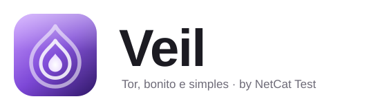
</picture>

**A rede Tor no Windows, bonita e simples. Um único executável, tudo local.**

[](#requisitos)
[](#stack)
[](https://www.torproject.org)
[](#)
[](LICENSE)
[](https://github.com/netcattest/veil/actions/workflows/build.yml)

**[⬇️ Baixar o Veil](https://github.com/netcattest/veil/releases/latest)**

🇧🇷 Português · [🇺🇸 English](README.en.md)

<br>

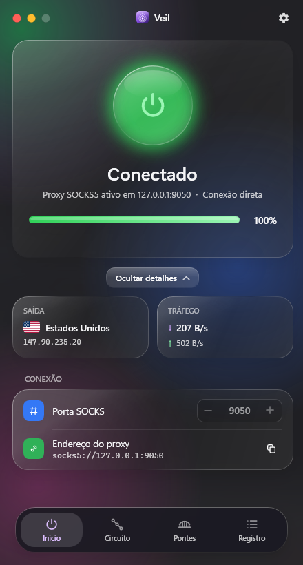&nbsp;&nbsp;
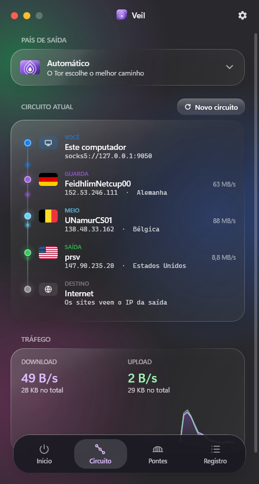&nbsp;&nbsp;
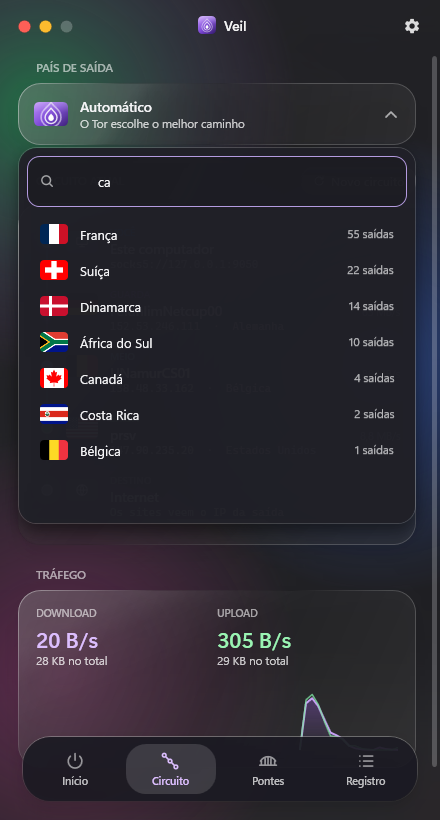

</div>

---

## ✨ O que é

O **Veil** é um painel de controle para o Tor feito para Windows. Ele traz o **Tor Expert Bundle oficial embutido** num único `Veil.exe`. Você liga e desliga a rede com um toque, escolhe a porta, usa pontes para driblar bloqueios, escolhe o país de saída e vê **o seu circuito em tempo real**: cada relay com bandeira, IP, país e banda.

Sem instalador, sem dependências e sem telemetria. A única conexão que o app faz por conta própria é buscar pontes novas, e só quando você clica em **Buscar do site**.

## 🧭 Recursos

| | |
|---|---|
| ⏻ **Ligar / desligar** | Botão de vidro com brilho, barra de progresso com a etapa real do bootstrap (inclusive os MB de descritores baixados) |
| 🔌 **Porta SOCKS5** | Escolha a porta (padrão `9050`) e copie o endereço do proxy com um clique |
| 🧅 **Circuito ao vivo** | Você → Guarda/Ponte → Meio → Saída → Internet, com bandeira, IP, país e banda de cada relay, e pontos animados mostrando o fluxo |
| 🌍 **País de saída** | Dropdown próprio com busca e 252 bandeiras, ordenado pela quantidade real de relays de saída por país (calculada do consenso local) |
| 🔄 **Novo circuito** | Pede uma nova identidade (`NEWNYM`) e mostra o circuito novo |
| 🌉 **Pontes** | obfs4, Snowflake e meek embutidas, ou **Personalizada**: busque obfs4/webtunnel do site oficial ou cole os dados da ponte |
| 📈 **Tráfego** | Download/upload por segundo, totais e um gráfico leve dos últimos 60 s |
| 🔎 **Pesquisa de relays** | Busque qualquer um dos ~9 mil relays por nome, IP, fingerprint ou país, filtre por Saída/Guarda e veja flags, banda, IPv6, versão e fingerprint |
| 📊 **Dados da rede** | Total de relays, saídas, guardas, países, banda total da rede e versão do Tor mais usada |
| 🗂️ **Bandeja** | Fechar mantém o Veil rodando; botão direito abre um menu de vidro com status, país, IP de saída e tráfego |
| 🚀 **Iniciar com o Windows** | Opcional (desligado por padrão): abre escondido na bandeja ao entrar no Windows |
| 📦 **Instalador** | `Veil-Setup.exe` instala sem administrador, cria atalhos e aparece em *Aplicativos instalados* |
| 🌐 **Idiomas** | Português e English, automático pelo idioma do sistema |
| 🫧 **Visual** | Acrílico real do Windows 11, cartões "liquid glass", Ajustes em tela cheia no estilo iOS, splash com o logo se desenhando, animação de abrir/fechar e efeito geleia ao arrastar |

## 📸 Telas

<div align="center">

| Início | Circuito | País de saída |
|:---:|:---:|:---:|
|  |  |  |
| **Pontes** | **Registro** | **Ajustes** |
| 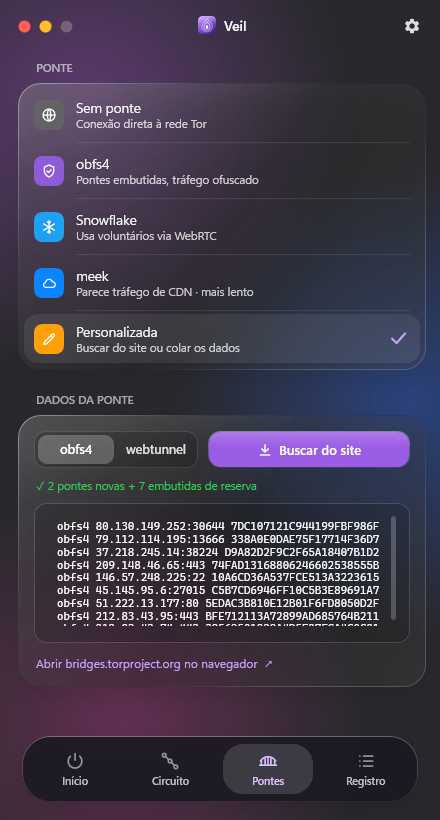 | 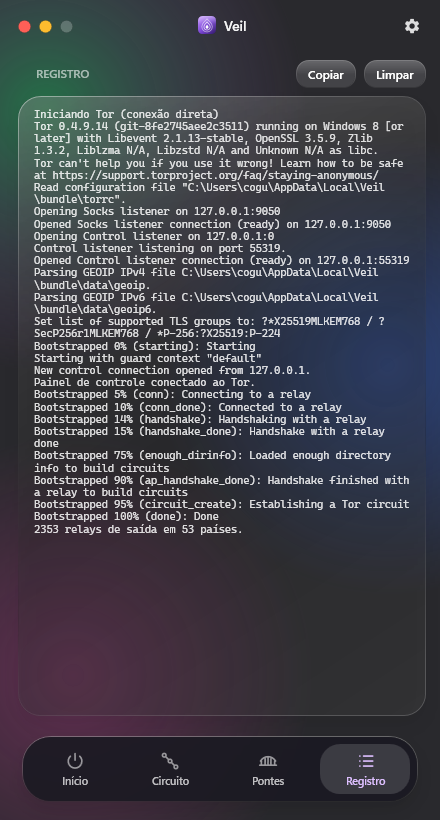 | 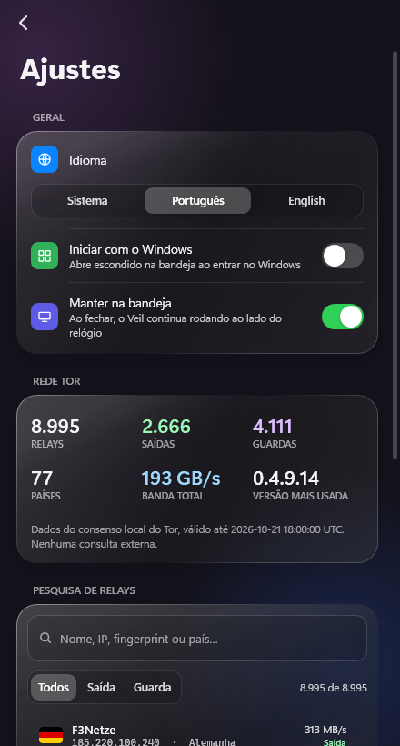 |
| **Pesquisa de relays** | **Instalador** | |
| 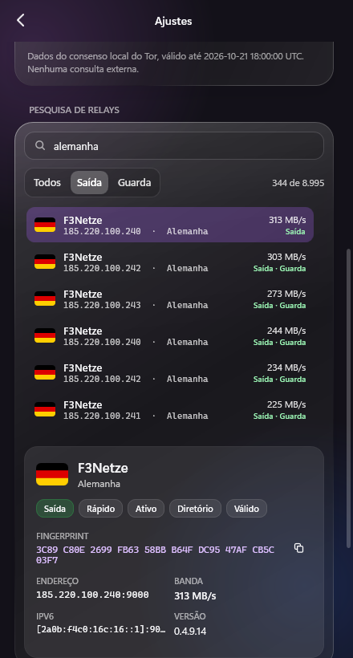 | 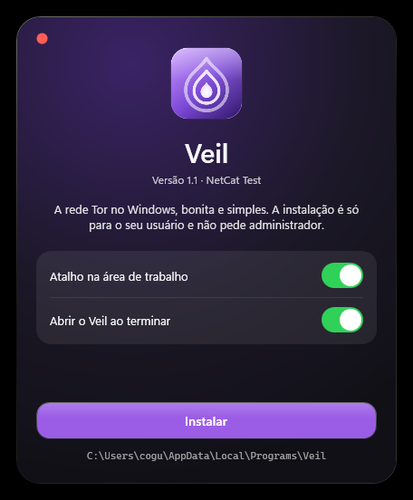 | |

</div>

## 🛠️ Como funciona

<div align="center">
</div>

1. **Primeira execução**: o `Veil.exe` extrai o Tor Expert Bundle embutido para `%LOCALAPPDATA%\Veil\bundle` (só uma vez por versão).
2. **Ao ligar**: o Veil gera um `torrc` com a porta SOCKS escolhida, as pontes e o país de saída, e inicia o `tor.exe` dentro de um *Job Object* do Windows. Se o Veil fechar ou travar, o Tor e os transports fecham junto.
3. **Progresso**: o Veil lê o log do Tor (stdout) e consulta `status/bootstrap-phase` a cada 0,5 s para mostrar a porcentagem exata.
4. **Dados ao vivo**: pela **ControlPort** local (porta aleatória, autenticação por cookie), o Veil consulta:

| Comando | Para quê |
|---|---|
| `GETINFO circuit-status` · `stream-status` | qual circuito está em uso agora |
| `GETINFO ns/id/<fingerprint>` | apelido, IP e banda de cada relay |
| `GETINFO ip-to-country/<ip>` | país do relay, pelo **GeoIP local** do Tor |
| `GETINFO traffic/read` · `traffic/written` | tráfego por segundo |
| `GETINFO ns/all` | conta os relays de saída por país, para ordenar a lista |
| `SETCONF ExitNodes={cc} StrictNodes=1` | troca o país de saída sem reiniciar |
| `SIGNAL NEWNYM` | novo circuito |

5. **Seus apps** usam o proxy `socks5://127.0.0.1:9050` (ou a porta que você escolher).
6. **Ajustes → Rede Tor e Pesquisa de relays**: o Veil lê direto o consenso que o Tor salvou em disco (`cached-microdesc-consensus`) e descobre o país de cada IP com o arquivo `geoip` embutido. Por isso funciona mesmo com o Tor desligado, desde que você já tenha conectado uma vez.

### 🔒 Privacidade

- **Nenhuma consulta externa** do próprio Veil, com uma exceção: a busca de pontes, que acontece **só quando você clica em "Buscar do site"**. Ela usa a API oficial **Moat** do `bridges.torproject.org` (a mesma do Tor Browser, sem CAPTCHA).
- Bandeiras, nomes de países e GeoIP já vêm **embutidos**. A pesquisa de relays e os dados da rede usam só arquivos locais.
- Configurações e cache do Tor ficam em `%LOCALAPPDATA%\Veil`. Para apagar tudo, basta remover essa pasta.

> [!IMPORTANT]
> O Veil fornece um **proxy Tor** para os seus apps. Ele **não** substitui o [Tor Browser](https://www.torproject.org/download/). Um navegador comum passando pelo Tor continua exposto a fingerprinting, cookies e logins. Para navegar com anonimato, use o Tor Browser.

## 🌉 Pontes

| Modo | Quando usar |
|---|---|
| **Sem ponte** | Rede livre: conexão direta e mais rápida |
| **obfs4** | Pontes embutidas que disfarçam o tráfego do Tor |
| **Snowflake** | Usa voluntários via WebRTC; bom quando o obfs4 está bloqueado |
| **meek** | Tráfego parecido com o de uma CDN; mais lento, mas difícil de bloquear |
| **Personalizada** | Busca **obfs4** ou **webtunnel** novas no site oficial (as obfs4 vêm com as embutidas de reserva) ou aceita linhas coladas, como `obfs4 1.2.3.4:443 FINGERPRINT cert=… iat-mode=0` |

## 🚀 Uso

1. Baixe em **[Releases](https://github.com/netcattest/veil/releases/latest)**:
   - **`Veil-Setup.exe`** (recomendado): instala para o seu usuário, sem administrador, com atalhos no Menu Iniciar e na área de trabalho. Para desinstalar, vá em *Configurações → Aplicativos instalados*.
   - **`Veil.exe`**: versão portátil, é só abrir.
2. Toque no botão central. Quando aparecer **Conectado**, configure seu app com o proxy **SOCKS5** `127.0.0.1:9050`.
3. No Firefox: *Configurações → Rede → Configuração manual → SOCKS v5*, e marque **"Usar proxy DNS ao usar SOCKS v5"**.
4. Teste com:

```bash
curl --socks5-hostname 127.0.0.1:9050 https://check.torproject.org/api/ip
```

> O SmartScreen pode avisar na primeira execução porque o executável ainda não é assinado: clique em **Mais informações → Executar assim mesmo**. Os hashes SHA-256 de cada versão vêm no arquivo `SHA256SUMS.txt` da Release.

### Requisitos

Windows 10 ou 11 (64 bits) com .NET Framework 4.8, que já vem no Windows. O vidro acrílico real exige Windows 11 22H2 ou superior; em versões anteriores, o Veil usa um fundo em gradiente.

## 🧱 Stack

| Camada | Tecnologia |
|---|---|
| Linguagem | **C# 5** compilado com o `csc.exe` do .NET Framework 4.8: sem Visual Studio, sem NuGet |
| Interface | **WPF** com XAML carregado em tempo de execução (`ui.xaml`, `tray.xaml`), templates próprios para tudo (botões, abas, listas, barra de rolagem, switch) |
| Vidro | `DwmSetWindowAttribute` (acrílico, modo escuro, cantos arredondados) + `WindowChrome` |
| Bandeja | `NotifyIcon` do WinForms com um menu WPF próprio |
| Tor | **Tor Expert Bundle 15.0.26** (tor 0.4.9.14, lyrebird, conjure) embutido como recurso |
| Controle | Cliente próprio do protocolo **ControlPort** do Tor sobre TCP, com autenticação por cookie |
| Processo | **Job Object** do Win32 (`KILL_ON_JOB_CLOSE`) + `__OwningControllerProcess` |
| Recursos | `tor.zip`, `flags.zip` (252 PNGs), `countries.json`, `favicon.ico`, tudo dentro do `.exe` |

## 🔨 Compilar

Só precisa de Windows com PowerShell (o compilador C# já vem com o .NET Framework).

```bash
powershell -ExecutionPolicy Bypass -File tools/fetch-tor.ps1
```

```bash
powershell -ExecutionPolicy Bypass -File build.ps1
```

O `fetch-tor.ps1` baixa o Tor Expert Bundle de `dist.torproject.org` e confere o SHA-256. O `build.ps1` empacota tudo e gera o `Veil.exe` e o instalador `Veil-Setup.exe` (~23 MB cada).

### CI/CD

O workflow [`build.yml`](.github/workflows/build.yml) roda no GitHub Actions (Windows) a cada push e pull request: baixa o Tor, compila e publica os executáveis como artefato. Ao enviar uma tag `v*` (por exemplo `git tag v1.1 && git push origin v1.1`), ele cria a Release automaticamente com `Veil-Setup.exe`, `Veil.exe` e `SHA256SUMS.txt`.

Para regerar o ícone a partir do SVG (usa o Microsoft Edge em modo headless) e as artes da documentação:

```bash
powershell -ExecutionPolicy Bypass -File tools/build-assets.ps1
```

```bash
python tools/make-docs-art.py
```

### Estrutura

```
src/Veil.cs            lógica do app, ControlPort, bandeja, animações
src/Setup.cs           instalador (Veil-Setup.exe)
src/ui.xaml            interface principal
src/tray.xaml          menu da bandeja
src/setup.xaml         interface do instalador
.github/workflows/     CI/CD (build e Releases)
assets/logo.svg        logo (fonte do favicon.ico)
assets/flags/          bandeiras PNG embutidas
assets/countries.json  nomes de países (pt/en)
tools/                 scripts de build, ícone, Tor e artes do README
docs/                  screenshots, wordmark e infográficos
```

## 🙏 Créditos

- [The Tor Project](https://www.torproject.org): Tor, lyrebird e a API Moat (licença BSD-3-Clause; os avisos dos componentes vão junto no bundle, em `docs/`)
- Bandeiras de [Flagpedia / flagcdn](https://flagpedia.net) (domínio público)
- Ícone de engrenagem baseado nos Material Icons (Apache 2.0)

O Veil é um projeto independente e **não é afiliado** ao Tor Project. "Tor" é marca registrada do The Tor Project, Inc.

## 📄 Licença

O código do Veil é distribuído sob a licença [MIT](LICENSE). O Tor e os demais componentes embutidos mantêm as suas próprias licenças.

---

<div align="center">

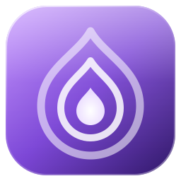

**Veil 1.1** · Criado por **[NetCat Test](https://netcattest.com)**

</div>
